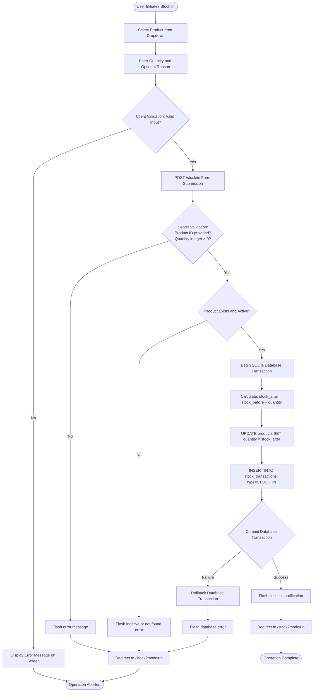
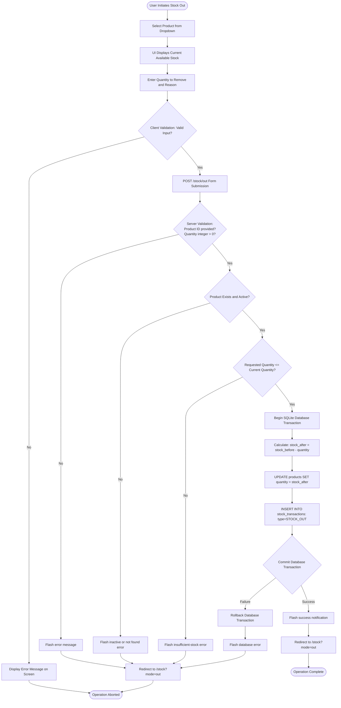
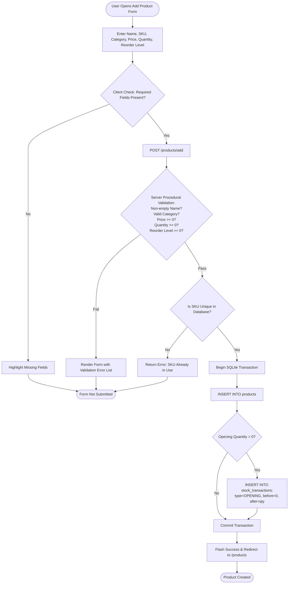

# Stockly — Workflow Flowcharts

This document illustrates the operational logic and decision paths implemented in Stockly using Mermaid flowcharts.

---

## 1. Stock In Workflow

The Stock In operation increases inventory quantity and creates an audit transaction log in an atomic database commit.

---

## 2. Stock Out Workflow

The Stock Out operation decrements on-hand inventory while enforcing strict checks against overselling.

---

## 3. Product Creation & Opening Stock Workflow

Product creation validates unique SKU constraints and logs an `OPENING` transaction if an initial stock quantity is provided.

